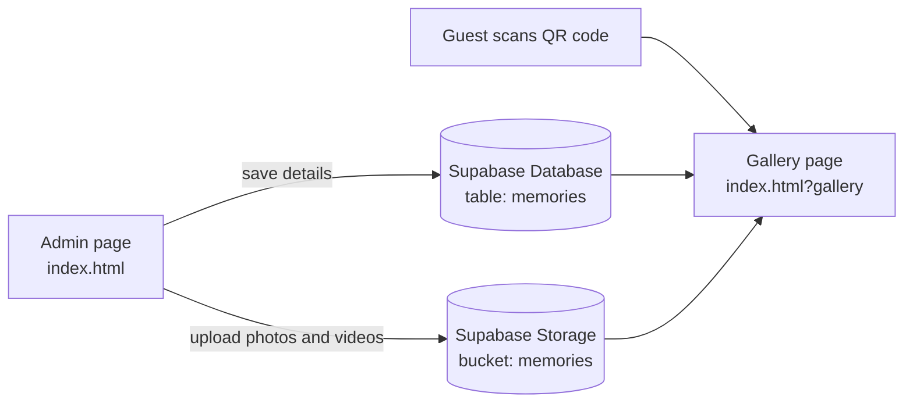

# 🕊️ Grandpa's Memories

> A photo and video memorial slideshow with a QR-code guest gallery, built for the 41st Ceremony on 19th November.


**Live website:** https://grandpaweb.vercel.app  
**Guest gallery (opened by the QR code):** https://grandpaweb.vercel.app/?gallery

---

## 📖 About

**Grandpa's Memories** is a simple, beautiful web page made for a family ceremony. The family's photos and videos play on a very large screen so everyone in the hall can see them. A small QR code in the header lets guests scan it with their phones and browse every photo and video in their own gallery.

The project has no build step. It is plain HTML, CSS and JavaScript, with Supabase used to save the photos and videos online.

## ✨ Features

**Ceremony slideshow**
- Large photo and video screen with the heading at the top
- Photos change after a set number of seconds; videos always play to the very end
- Page-turn animation between memories
- Optional captions on each photo or video
- Background music with a volume slider (music pauses while a video plays with its own sound)
- Shuffle, fullscreen and a clean **Presentation mode** that hides the admin panels
- Keyboard shortcuts and touch swipe on phones and tablets

**QR guest gallery**
- Small QR code in the header; click it to show a bigger one
- Scanning opens a mobile-friendly gallery of all saved photos and videos
- Tap any memory to open it full size, then swipe or use the arrows to move through them
- Shows the number of photos and videos
- Credit at the bottom: *Website made with love by GLADSON C ANTO*

**Admin tools**
- Add photos and videos, or a whole folder at once
- Every file shows a status: *Waiting*, *Saving*, *Saved to QR gallery* or *Not saved · Retry*
- Edit captions, change the order and remove items
- Change the title, dedication and seconds per photo

## 🧭 How it works



The same `index.html` and `app.js` show two different pages. Opening the site normally shows the ceremony slideshow. Adding `?gallery` to the address shows the guest gallery.

## 🛠️ Tech stack

| Part | Technology |
| --- | --- |
| Pages and styling | HTML5, CSS3 |
| Logic | Vanilla JavaScript |
| Database and file storage | [Supabase](https://supabase.com) (Postgres and Storage) |
| QR code | [qrcodejs](https://github.com/davidshimjs/qrcodejs) |
| Supabase client | [supabase-js](https://github.com/supabase/supabase-js) (loaded from a CDN) |
| Hosting | GitHub and [Vercel](https://vercel.com) |

## 📁 Project structure

```
.
├── index.html           # Page layout and styles (slideshow + guest gallery)
├── app.js               # All the logic: slideshow, uploads, QR code, gallery
├── supabase-setup.sql   # Creates the table, storage bucket and permissions
├── .gitignore           # Keeps secret files out of GitHub
└── README.md
```

## 🚀 Getting started

### What you need
- A free [Supabase](https://supabase.com) account
- [Visual Studio Code](https://code.visualstudio.com) with the **Live Server** extension
- A GitHub account and a Vercel account (to put the site online)

### 1. Get the code
```bash
git clone <your-repository-url>
cd <your-repository-folder>
```

### 2. Set up Supabase
1. Create a new project in Supabase.
2. Open **SQL Editor → New query**, paste everything from `supabase-setup.sql` and click **Run**.
3. Open **Project Settings → API Keys** and copy your **Project URL** and your **Publishable key** (it starts with `sb_publishable_`).

### 3. Add your settings to `app.js`
Open `app.js` and fill in the `CONFIG` block at the top:

```js
const CONFIG = {
  SUPABASE_URL: "https://YOUR-PROJECT-ID.supabase.co",
  SUPABASE_ANON_KEY: "sb_publishable_xxxxxxxxxxxxxxxx", // publishable key ONLY
  BUCKET: "memories",                                    // keep this name
  PUBLIC_SITE_URL: "https://your-site.vercel.app"        // the QR code points here
};
```

> ⚠️ Use the **publishable** key only. Never put a `sb_secret_` or `service_role` key in `app.js`. Browsers expose everything in this file.

### 4. Test on your computer
Right-click `index.html` in VS Code and choose **Open with Live Server**. To test the guest gallery, add `?gallery` to the address, for example `http://127.0.0.1:5500/index.html?gallery`.

> The QR code always points to `PUBLIC_SITE_URL`, so on your computer open the `?gallery` address yourself instead of scanning.

### 5. Put it online
1. Push the project to GitHub.
2. In Vercel, click **Add New → Project** and import the repository.
3. Leave the build command empty (framework preset: **Other**) and click **Deploy**.
4. Copy your live address into `PUBLIC_SITE_URL` in `app.js`, then commit and push again.

## 🎮 Using the website

1. Open the website and go to **01 · Add your memories**.
2. Click **Choose photos and videos** (or **Choose folder**) and wait until every file shows **☁ Saved to QR gallery**.
3. Optionally add captions, change the order, set the title and choose background music.
4. Click **▶ Play slideshow**, then **⛶ Fullscreen** or **◐ Presentation mode** for the ceremony.

### Keyboard shortcuts

| Key | Action |
| --- | --- |
| `←` / `→` | Previous / next memory |
| `Space` | Play or pause the slideshow |
| `F` | Fullscreen |
| `M` | Mute or unmute video |
| `Esc` | Stop the slideshow |

## 🔒 Security notes

- Only the **publishable** key belongs in `app.js`. Keep `.env` files, secret keys and database passwords out of GitHub (they are listed in `.gitignore`).
- If a secret key or password was ever shown publicly, create a new one in Supabase and delete the old one.
- The permissions in `supabase-setup.sql` let anyone who knows the website address add or delete memories. This is fine for a private family event. For wider use, add an admin sign-in or PIN and tighten the permissions.

## 🩺 Troubleshooting

| Problem | Likely cause and fix |
| --- | --- |
| QR page says **"Could not load the memories"** | Read the **Details** line under the message. The usual causes are a secret key in `app.js`, `supabase-setup.sql` not run yet, or an old version of the website still deployed. |
| A file shows **⚠ Not saved · Retry** | The reason appears in the status line at the bottom of the page. Free Supabase plans allow about 50 MB per file, so very large videos need to be shortened or compressed first. |
| QR code shows **"QR not active yet"** | `SUPABASE_URL` or the key is missing in `app.js`, or the Supabase script did not load. Check your internet connection. |
| Changes do not appear on the live site | Commit and push to GitHub, then wait until the latest Vercel deployment says **Ready**. |

## 🔮 Future improvements

- Admin PIN or sign-in for the upload panel
- Automatic photo and video compression before upload
- Download-all option for the family

## 👤 Author

**Gladson C Anto**  
AI & Data Science Developer · B.Tech Artificial Intelligence & Data Science

---

<p align="center"><i>Made with love in memory of Grandpa. Forever loved, always remembered.</i></p>
